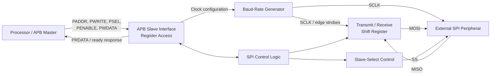

# APB Interface SPI Master IP Core RTL Design

A Verilog RTL project focused on an **SPI master controlled through an AMBA APB programming interface**. The intended system-level use is to let a processor or APB bus master configure an SPI controller through memory-mapped registers and communicate with an external SPI peripheral.

This repository is being organized as a technical portfolio for RTL design and verification. Documentation and results are included only where they can be supported by the files currently available in the repository.

## Contents

- [Project Overview](#project-overview)
- [Architecture](#architecture)
- [Functional Blocks](#functional-blocks)
- [Baud-Rate Generator](#baud-rate-generator)
- [SPI Signals](#spi-signals)
- [Repository Layout](#repository-layout)
- [Simulation and Verification](#simulation-and-verification)
- [Linting and Synthesis](#linting-and-synthesis)
- [Tools](#tools)
- [Running the Project](#running-the-project)
- [Future Improvements](#future-improvements)
- [Acknowledgments](#acknowledgments)
- [License](#license)

## Project Overview

The design combines two interfaces with different responsibilities:

- **APB programming interface:** provides access to the controller's configuration, data, and status registers.
- **SPI serial interface:** communicates with an external peripheral using `SCLK`, `MOSI`, `MISO`, and slave-select (`SS`) signals.

The project is structured around these hardware functions:

- APB slave/register interface
- SPI control and transfer sequencing
- Programmable baud-rate generation
- Serial transmit/receive shift logic
- Slave-select control

The public repository should be treated as the source of truth for what is currently available to review. Testbenches, reports, diagrams, and any additional RTL modules should be added to the repository before results based on them are described as reproducible.

## Architecture

The following is a **high-level functional view** of the intended IP. The exact module hierarchy and signal-level connections should be read from the corresponding RTL source files.



**Interface distinction:** APB is used to configure and access the IP; SPI is used for serial data transfer with the external peripheral. The APB master/processor is outside this IP core unless a top-level integration explicitly includes it.

## Functional Blocks

| Block | Responsibility |
|---|---|
| APB slave interface and registers | Accepts bus accesses and exposes configuration, data, and status fields. Register addresses and bit-level behavior should be documented from the actual RTL. |
| SPI control logic | Coordinates transfer activity and the interaction between configuration, clock generation, data shifting, and slave select. |
| Baud-rate generator | Derives SPI clock timing from the peripheral clock and produces timing/edge signals for serial transfer logic. |
| Shift-register logic | Supports parallel/serial conversion for transmitted and received data. |
| Slave-select control | Controls the peripheral selection signal during a transfer. |

The table describes the design's functional partitioning; it does not imply that every block is a separately instantiated module in the currently published source tree.

## Baud-Rate Generator

The committed RTL file `rtl/baudrate.v` defines the module `baud_rate_generator`.

Its interface includes the peripheral clock and active-low reset (`pclk`, `preset_n`), SPI configuration inputs (`spi_mode`, `spiswai`, `sppr`, `spr`, `cpol`, `cpha`, `ss_n`), the generated serial clock (`sclk`), edge-control outputs, and a baud-rate divisor output.

The divisor expression in the RTL is:

```verilog
baudratedivisor = (sppr + 1) * 2**(spr + 1);
```

The generator counts peripheral-clock cycles and toggles `sclk` when its counter reaches the half-divisor threshold. The reset/idle clock level is selected from `cpol`. Clock generation is gated by the implemented `spi_mode`, `spiswai`, and `ss_n` conditions.

The module also produces control strobes associated with sampling `MISO` and shifting `MOSI`. Their precise timing should be evaluated against the RTL and simulation waveforms before using the design in an integration.

**Important:** The divisor formula alone does not establish a complete supported-frequency range or prove that all SPI modes operate correctly. Those claims require simulation evidence across the relevant configuration combinations.

## SPI Signals

| Signal | Typical role |
|---|---|
| `SCLK` | Serial clock generated by the SPI master |
| `MOSI` | Master Out, Slave In: data sent from the master |
| `MISO` | Master In, Slave Out: data received by the master |
| `SS` | Slave-select signal used to select the target peripheral |

Signal polarity, reset values, active levels, and edge behavior should be confirmed from the top-level RTL and timing waveforms.

## Repository Layout

The repository is intended to use the following organization. Some directories may be empty until their associated project artifacts are added.

```text
APB-SPI-Master-IP-Core/
├── README.md
├── LICENSE
├── .gitignore
├── rtl/
│   └── baudrate.v
├── tb/
├── docs/
│   ├── architecture/
│   ├── waveforms/
│   ├── lint/
│   └── synthesis/
├── scripts/
└── results/
```

- `rtl/` — Verilog RTL source files.
- `tb/` — simulation testbenches.
- `docs/architecture/` — architecture and microarchitecture diagrams.
- `docs/waveforms/` — waveform screenshots used to explain real simulation runs.
- `docs/lint/` — lint logs and reports.
- `docs/synthesis/` — synthesis reports and supporting documentation.
- `scripts/` — reproducible tool scripts.
- `results/` — selected results and summary documentation.

Keep this tree synchronized with the actual files committed to GitHub. Remove entries for directories that do not exist in the repository.

## Simulation and Verification

Simulation should be documented using the actual testbench, compile/run commands, logs, and waveforms committed to the repository.

Recommended scenarios for this IP include:

- Reset and idle behavior
- APB register reads and writes
- Register address decoding
- Baud-rate and `SCLK` timing
- Serial transmission and reception
- CPOL/CPHA timing combinations supported by the RTL
- Slave-select assertion and deassertion
- Transfer completion and status behavior

These are recommended verification scenarios, **not a claim that each has passed**. Add a scenario to the completed-results table only after checking the corresponding simulation output.

| Verification item | Status | Evidence |
|---|---|---|
| Testbench execution | Not documented in this repository snapshot | Add test command and log |
| APB access behavior | Not documented in this repository snapshot | Add relevant waveform/log |
| Baud-rate generator | RTL source is present; result not documented here | Add testbench and waveform |
| SPI transmit/receive | Not documented in this repository snapshot | Add serial-transfer waveform |
| SPI mode combinations | Not documented in this repository snapshot | Add results for each tested configuration |

Suggested waveform captures should have readable signal names, useful time ranges, and a caption explaining what the reader should observe. Screenshots should come from actual simulation runs rather than illustrative or fabricated waveforms.

## Linting and Synthesis

### RTL linting

Document the lint tool, version, command, warnings/errors, and final status from the actual lint log. Do not report a clean lint result or warning count without the report.

### Synthesis

If synthesis has been run, document the tool, target technology/device, and actual results. Suitable metrics may include cell/logic utilization and timing, depending on the flow. Do not infer synthesis success from compilation or simulation, and do not publish estimated area, power, or timing figures without supporting reports.

## Tools

The project uses Verilog HDL. Simulation, waveform analysis, linting, and synthesis tools should be listed here only when confirmed by project files or actual run logs.

| Activity | Tool / evidence |
|---|---|
| RTL design | Verilog HDL |
| Simulation | Add the tool and version used for the committed testbench |
| Waveform analysis | Add the viewer used for the committed waveforms |
| Linting | Add the tool and version from the lint report |
| Synthesis | Add the tool and version if synthesis was performed |
| Version control | Git and GitHub |

## Running the Project

The exact simulation command depends on the top-level RTL, module dependencies, and testbench files. Use an explicit source-file list so unrelated modules or multiple testbenches are not compiled together accidentally.

Clone the repository:

```bash
git clone https://github.com/mdfaiz9630-prog/APB-SPI-Master-IP-Core.git
cd APB-SPI-Master-IP-Core
```

For an Icarus Verilog flow, the general sequence is:

```bash
iverilog -o sim.out <required-rtl-files> <testbench-file>
vvp sim.out
```

If the testbench writes a VCD file, open that generated file with GTKWave:

```bash
gtkwave <generated-waveform>.vcd
```

Replace the angle-bracketed placeholders with the actual filenames. These are command templates, not verified copy-and-paste commands for the current repository snapshot. Once the complete RTL and testbench are committed, add the exact tested command and expected output here.

## Future Improvements

Potential next steps for strengthening the project and its evidence include:

- Publish the complete RTL hierarchy and top-level integration.
- Add reproducible testbenches and simulation commands.
- Add self-checking tests for APB accesses and SPI data transfers.
- Capture representative, real simulation waveforms.
- Expand testing across supported baud-rate and SPI-mode configurations.
- Archive lint reports and document any warnings or fixes.
- Add synthesis results if a synthesis run is completed.
- Consider SystemVerilog assertions, functional coverage, or a UVM environment as future verification enhancements.

These are improvement ideas, not claims that the items have already been implemented.

## Acknowledgments
This project was undertaken as part of my RTL design training at Maven Silicon. The project concept and learning assignment were provided by Maven Silicon, while the RTL implementation and project work were carried out as part of my training. This repository documents my learning and implementation of an APB Interface SPI Master IP Core using Verilog.
